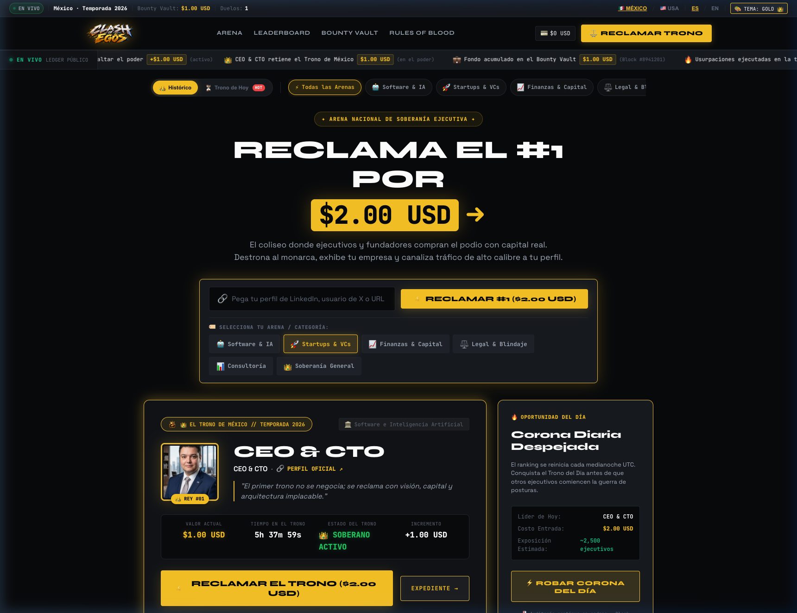
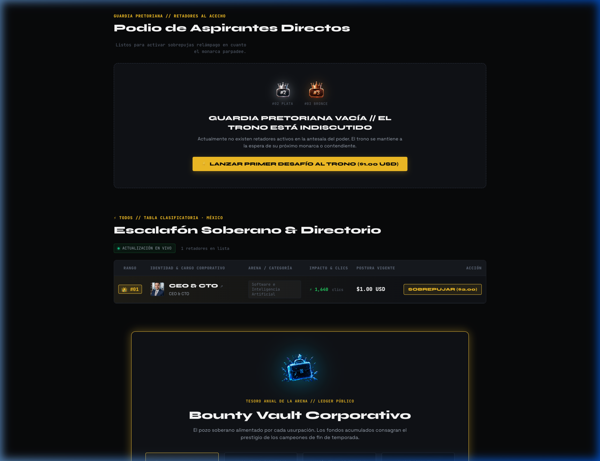
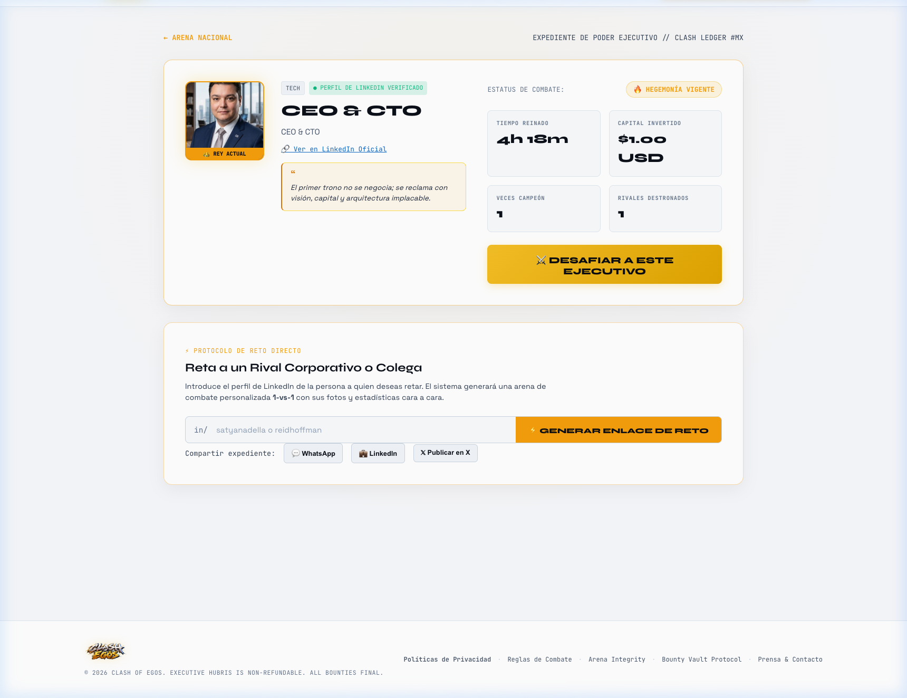
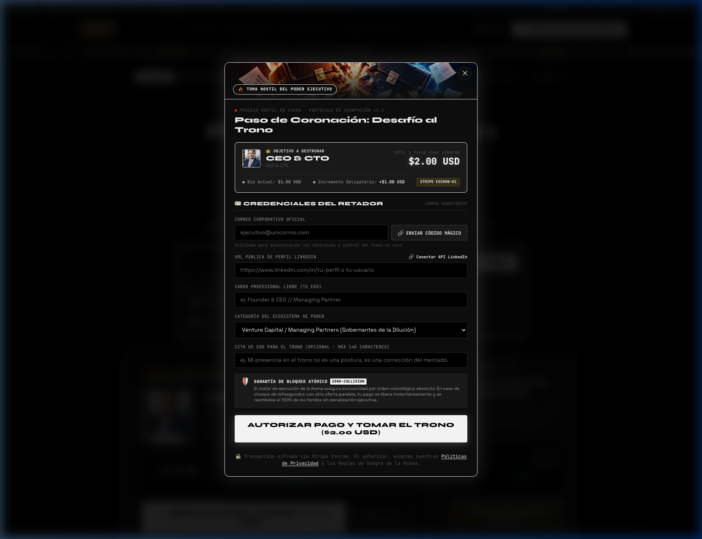
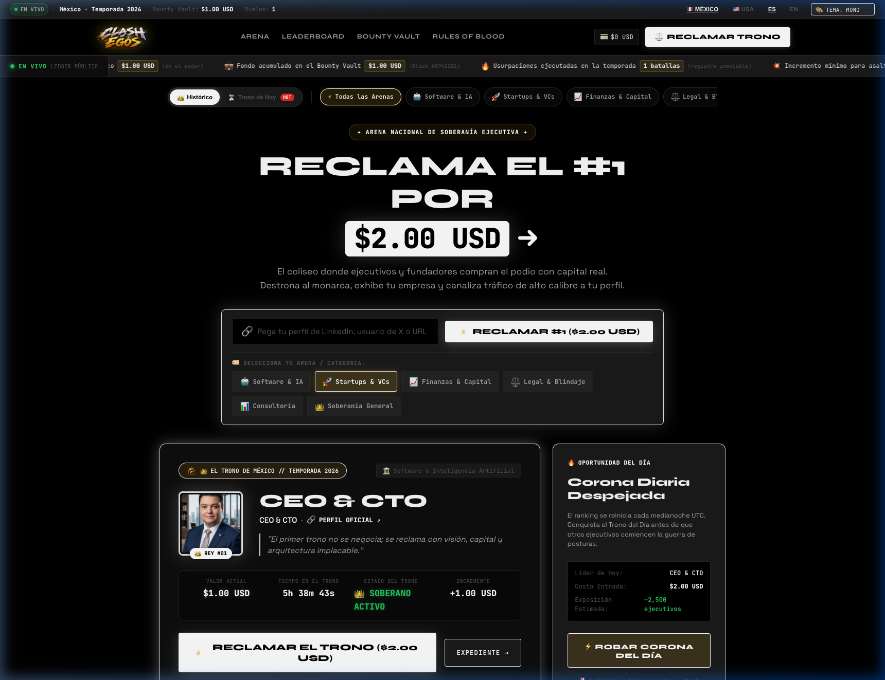
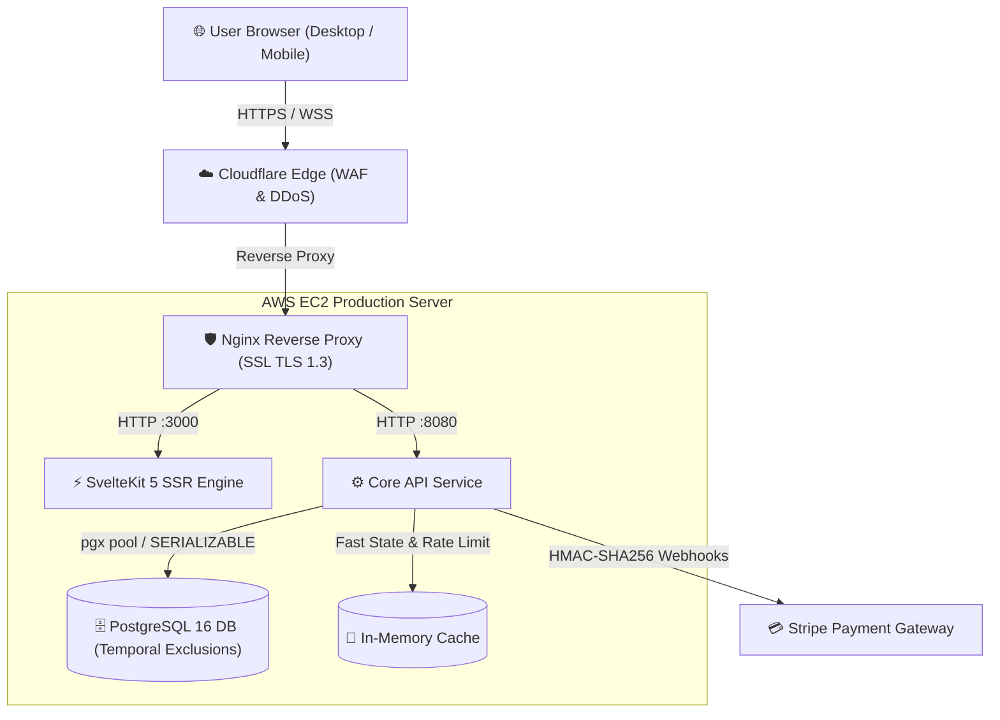

<div align="center">

# 👑 CLASH OF EGOS
### The Sovereign Executive Arena · Commercial Architecture Showcase

[](https://clashofegos.lol)
[](https://svelte.dev)
[](https://www.postgresql.org)
[](https://aws.amazon.com)
[](https://stripe.com)
[](./LICENSE)

<br />

**[🌐 Launch Live Arena](https://clashofegos.lol)** · **[👔 View Founder Profile](https://clashofegos.lol/c/jesus-cabrerareveles)** · **[📐 System Architecture](./docs/ARCHITECTURE.md)** · **[🛡️ Security Specifications](./docs/SECURITY_AUDIT.md)**

<br />

<p align="center">
  
</p>

</div>

---

## 📌 Executive Summary

**Clash of Egos** is a high-stakes, real-time social capital platform where startup founders, C-level executives, and venture investors compete for the sovereign digital spotlight through financial liquidity and prestige.

Users place bids via Stripe to usurp the active Monarch, claim the #1 global spotlight, and drive verified high-intent traffic to their LinkedIn profiles and venture websites. The system features dynamic pricing (+10% minimum outbid increments), regional sovereignty arenas (Mexico & United States), real-time financial marquees, and automated verifiable executive credentials.

> **Note on Proprietary Codebase:**  
> This showcase repository provides an architectural, visual, and operational review of the system. In accordance with commercial trade secret protection, the private business logic, database migrations, and production secrets remain strictly hosted in private repositories. All system designs, invariants, and architectural solutions documented here represent the production system operating live at [https://clashofegos.lol](https://clashofegos.lol).

---

## 📸 Platform Showcase & Visual Experience

### 1. The Sovereign Monarch Throne & Real-Time Marquee
The primary arena displays the active monarch, dynamic outbid cost, real-time financial news marquee, and zero-friction challenge interface.

<p align="center">
  
</p>

---

### 2. Praetorian Podium & Contender Leaderboard
Ranks #2 and #3 flank the throne with real-time liquidity deficits, while the comprehensive directory organizes corporate challengers across Software & AI, Startups & VCs, Capital & Finance, and Media.

<p align="center">
  
</p>

---

### 3. Executive Identity & Social Capital Profile (`/c/{slug}`)
Dynamic executive portfolio pages featuring social verification, total throne holding duration, total capital deployed, and customized badges.

<p align="center">
  
</p>

---

### 4. Zero-Friction Usurpation & Stripe Checkout
Instant bid creation with multi-currency support (USD/MXN), automatic tax handling, and instant cryptographic settlement.

<p align="center">
  
</p>

---

### 5. Dual-Palette Luxury Styling (Dark / Wall Street White)
Users can toggle between the signature *High-Net-Worth Stealth Dark* theme and the *Wall Street Luxury White* theme with zero Cumulative Layout Shift (CLS).

<p align="center">
  
</p>

---

## 🛠️ Technology Stack Breakdown

| Layer | Technologies | Architectural Rationale |
| :--- | :--- | :--- |
| **Frontend Framework** | **SvelteKit 5 (Runes: `$state`, `$derived`, `$effect`)** | Near-zero runtime overhead, fine-grained reactivity, lightning-fast SSR, and superior Core Web Vitals. |
| **Language** | **TypeScript 5.x & Go 1.22+** | End-to-end static typing, zero runtime type errors, and shared data contracts across microservices. |
| **Styling & UI** | **Vanilla Scoped CSS / Design Tokens** | Handcrafted luxury aesthetic with glassmorphism, gold accents, CSS variables, and zero bundle bloat. |
| **Database** | **PostgreSQL 16 with `btree_gist`** | ACID compliance, temporal exclusion constraints to prevent overlapping reigns, and integer minor units for financial precision. |
| **Payments** | **Stripe API + Webhook Engine** | Provider-agnostic payment abstraction with cryptographic HMAC-SHA256 signature verification and idempotent reconciliation. |
| **Reverse Proxy** | **Nginx + Let's Encrypt TLS 1.3** | High-concurrency connection pooling, SSL termination, HTTP/2 streaming, and security headers (HSTS, CSP). |
| **Infrastructure** | **AWS EC2 (Ubuntu 24.04 LTS) + Docker Compose** | Containerized multi-stage builds, isolated network bridges, healthchecks, and zero-downtime rolling deploys. |
| **Internationalization** | **Bilingual Engine (ES / EN)** | Multi-locale dictionary stores with country detection (Mexico & US arenas). |

---

## 🧠 Key Engineering Challenges & Solutions

### 1. Temporal Concurrency: Zero-Collision Throne Usurpation
* **Problem:** In high-velocity bidding windows, multiple contenders can trigger payment checkouts simultaneously. A naive system risks granting duplicate active reigns or overwriting bids.
* **Solution:** Database-level temporal exclusion constraint using PostgreSQL's `btree_gist` extension, coupled with `SERIALIZABLE` transaction isolation:
  ```sql
  ALTER TABLE reigns ADD CONSTRAINT no_overlapping_active_reigns 
  EXCLUDE USING gist (
      season_id WITH =,
      tstzrange(started_at, COALESCE(ended_at, 'infinity'::timestamptz)) WITH &&
  ) WHERE (status = 'valid');
  ```
* Read the complete [Concurrency Specification in ARCHITECTURE.md](./docs/ARCHITECTURE.md).

### 2. Idempotent Financial Webhook Pipeline
* **Problem:** Network retries from Stripe or malicious replay attacks could cause double-bidding or fraudulent throne acquisitions.
* **Solution:** An asynchronous webhook verification pipeline enforcing timestamp expiration (rejecting events > 300 seconds), constant-time HMAC-SHA256 signature matching, and a persistent `processed_events` idempotency table executed in the same database transaction.
* Read the complete [Security Hardening in SECURITY_AUDIT.md](./docs/SECURITY_AUDIT.md).

### 3. Dynamic Viral OpenGraph Card Generation
* **Problem:** High-net-worth users share their victories on LinkedIn and X. Generic link previews hurt viral engagement.
* **Solution:** SvelteKit server hooks dynamically render custom OpenGraph `<meta>` tags for every `/c/{slug}` route, including the user's executive title, avatar, throne duration, and current status.

---

## 🏛️ System Architecture Diagram



---

## 👨‍💻 Founder & Principal Engineer

**Jesús Cabrera Reveles**  
*CEO & CTO — Clash of Egos*

* 🌐 **Live Platform:** [https://clashofegos.lol](https://clashofegos.lol)
* 👔 **Executive Profile:** [clashofegos.lol/c/jesus-cabrerareveles](https://clashofegos.lol/c/jesus-cabrerareveles)
* 💼 **LinkedIn:** [linkedin.com/in/jesus-cabrerareveles](https://www.linkedin.com/in/jesus-cabrerareveles)
* 🐙 **GitHub:** [@JesusCabreraReveles](https://github.com/JesusCabreraReveles)

---

## 📄 License & Commercial Notice

All rights reserved © 2026 Jesús Cabrera Reveles.  
This repository is published exclusively as an engineering architecture showcase. Unauthorized copying, distribution, or reverse engineering of the production systems and proprietary codebase of **Clash of Egos** is strictly prohibited. See [LICENSE](./LICENSE) for full legal terms.
