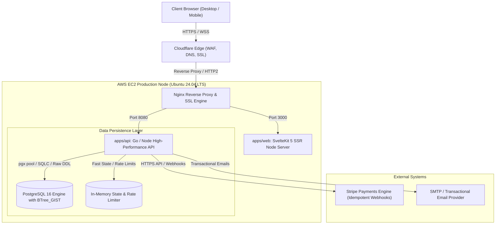
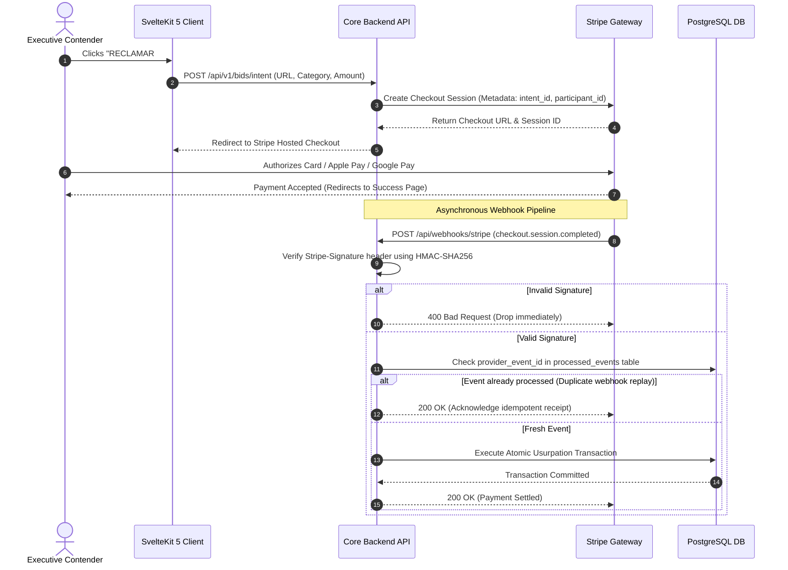

# Architecture & System Design Specification

This document details the software architecture, concurrency model, financial consistency guarantees, and infrastructure topology powering **Clash of Egos** ([clashofegos.lol](https://clashofegos.lol)).

---

## 1. High-Level System Topology

The platform operates on a resilient, low-latency microservices architecture deployed on **AWS EC2**, fronted by **Cloudflare** for edge caching and DDoS mitigation, with **Nginx** acting as a high-throughput reverse proxy and SSL terminator.



---

## 2. Temporal Concurrency & Atomic Throne Usurpation

In a real-time competitive bidding arena where capital dictates supremacy, **race conditions are fatal**. If two executives attempt to usurp the throne at the exact same millisecond, the system must guarantee absolute serializability: exactly one candidate ascends, the other is notified/refunded, and zero double-reigns ever exist.

### Core Domain Invariants
1. **Throne Exclusivity:** For any given competition (e.g. `mexico`, `usa`) and active season, at any instant $T$, **there exists at most one active reign** (`ended_at IS NULL`).
2. **Financial Atomicity:** All monetary amounts are recorded in minor integer units (cents/centavos) using 64-bit integers (`bigint`), eliminating floating-point rounding errors.
3. **Immutability of Audit Trails:** Records in `bids`, `reigns`, and `payments` are append-only. Cancellations and administrative actions create voided audit entries rather than destructive deletes.

### State Transition Diagram (Bid Lifecycle)

```mermaid
stateDiagram-v2
    [*] --> Draft : User enters URL & category
    Draft --> ReadyForPayment : System calculates required min bid (+10% or min floor)
    ReadyForPayment --> PaymentPending : Stripe Checkout Session Created
    
    state PaymentProcessing {
        PaymentPending --> WebhookReceived : Stripe triggers checkout.session.completed
        WebhookReceived --> SignatureVerification : HMAC-SHA256 validated
        SignatureVerification --> DatabaseLock : Acquire Advisory / Row Lock
    }

    DatabaseLock --> UsurpationSuccess : Bid > Current Monarch (Atomic Transact)
    DatabaseLock --> StaleBidVaulted : Throne was outbid during payment window
    
    UsurpationSuccess --> ReignActive : Old reign terminated (dethroned); New reign opened
    StaleBidVaulted --> RefundOrCredit : Accumulated to Contender Vault / Refunded
    
    ReignActive --> [*] : Season Concluded or Outbid by Next Challenger
```



---

## 3. PostgreSQL Physical Data Model & Exclusion Constraints

To enforce the single-reign invariant at the database engine level (rather than relying solely on application-layer logic), the schema employs PostgreSQL temporal ranges with the `btree_gist` extension:

```sql
-- Enforce that no two valid reigns for the same season overlap in time
CREATE EXTENSION IF NOT EXISTS "btree_gist";

ALTER TABLE reigns 
ADD CONSTRAINT no_overlapping_active_reigns 
EXCLUDE USING gist (
    season_id WITH =,
    tstzrange(started_at, COALESCE(ended_at, 'infinity'::timestamptz)) WITH &&
)
WHERE (status = 'valid');
```

When a new usurpation transaction executes:
```sql
BEGIN TRANSACTION ISOLATION LEVEL SERIALIZABLE;

-- 1. Lock the active season row to serialize concurrent claims
SELECT id, current_monarch_id, min_next_bid_cents 
FROM seasons 
WHERE id = $1 AND status = 'active' 
FOR UPDATE;

-- 2. Verify bid meets minimum threshold
-- 3. Close the previous active reign
UPDATE reigns 
SET ended_at = NOW(), end_reason = 'dethroned' 
WHERE season_id = $1 AND ended_at IS NULL;

-- 4. Insert new reign and bid record
INSERT INTO reigns (season_id, participant_id, bid_id, started_at, status)
VALUES ($1, $2, $3, NOW(), 'valid');

-- 5. Update season cache pointers
UPDATE seasons 
SET current_monarch_id = $2, 
    highest_bid_cents = $4,
    min_next_bid_cents = $4 + CEIL($4 * 0.10)
WHERE id = $1;

COMMIT;
```

---

## 4. Payment Webhook Security & Idempotency Pipeline



---

## 5. Frontend Architecture & High-Performance Design System

The client layer is engineered with **SvelteKit 5** (utilizing modern Runes: `$state`, `$derived`, `$effect`) for near-zero runtime overhead and ultra-fast Hydration:

* **Hydration Speed:** Lightweight bundle with no bloated framework dependencies.
* **Dual Aesthetic Engine:** Native dual-palette engine allowing instant toggle between **Stealth High-Net-Worth Dark Mode** and **Wall Street Luxury White Mode**, preserved via client-side local storage with zero cumulative layout shift (CLS).
* **Multi-Market Partitioning:** Complete geographical isolation (`MX` vs `US`) with localized currencies (USD/MXN), cultural messaging, and independent monarch arenas.
* **Dynamic OpenGraph Generation:** Automated server-side rendering of dynamic OpenGraph metadata for executive profiles (e.g. `/c/{slug}`), ensuring previews on LinkedIn, X, and WhatsApp display live reign stats, badges, and verified titles.
